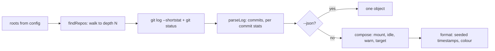

```
██████╗  ██████╗  ██████╗ ████████╗██╗      ██████╗  ██████╗
██╔══██╗██╔═══██╗██╔═══██╗╚══██╔══╝██║     ██╔═══██╗██╔════╝
██████╔╝██║   ██║██║   ██║   ██║   ██║     ██║   ██║██║  ███╗
██╔══██╗██║   ██║██║   ██║   ██║   ██║     ██║   ██║██║   ██║
██████╔╝╚██████╔╝╚██████╔╝   ██║   ███████╗╚██████╔╝╚██████╔╝
╚═════╝  ╚═════╝  ╚═════╝    ╚═╝   ╚══════╝ ╚═════╝  ╚═════╝
```

<div align="center">

### `YOUR DAY, AS DMESG // NOTHING IS INVENTED EXCEPT THE FRAMING`

*scans your repos, reads today's commits, prints them as a kernel boot log*


*recorded against `tapes/fixture.ts`, so those repos are invented; the log is not*

</div>

---

## 🖥 What is this

`bootlog` walks the directories you point it at, finds every git repository, asks git what happened in each one today, and prints the answer as a boot log. Repos with commits get mounted. Repos without get listed as idle. Uncommitted files come out as warnings, because that is what they are.

The framing is a joke and the data is not. Every line traces back to a `git log` or a `git status` against a real path, so a day where you did nothing prints a day where you did nothing. The timestamps in the left column are generated from the date rather than measured, which is the one honest lie in the output: they are there because a boot log without them is just a list.

It makes no network calls, writes nothing except its own config file, and reads no repository it was not pointed at.

```console
nick@bootlog:~$ bootlog
[   0.008495] breakOS 0.1.0 (nick@Nicks-MacBook-Pro.local) #16 Sun Aug 16 2026
[   0.408409] probe: 3 volumes detected
[   1.039634] .dotfiles: 2 commits, +61 -60
[   1.499393] idle: 2 volumes saw no writes (ai-detect, ia-graph)
[   1.872927] reached target Daily Work (2 commits across 1 repo, +61 -60)
```

## 💾 The log

| | line | what it actually reports |
|---|---|---|
| 01 | **probe** | how many git repos were found under your configured roots |
| 02 | **mount** | one per repo with commits in the window, with its current branch |
| 03 | **commit lines** | short hash and subject, straight from `git log` |
| 04 | **idle** | repos that exist but saw no writes, named so you remember they are there |
| 05 | **warn** | uncommitted file counts, per repo, from `git status --porcelain` |
| 06 | **reached target** | commits, repos touched, insertions and deletions for the day |
| 07 | **`--since`** | any git date expression, so `--since "3 days ago"` boots a longer day |

## 🚀 Run it

Needs [Bun](https://bun.sh) and `git`. No account, no network.

```bash
git clone https://github.com/nitrimandylis/bootlog.git
cd bootlog
bun run compile   # → ~/.bun/bin/bootlog, and man bootlog into your manpath
bootlog           # writes ~/.config/bootlog/config.json on first run
man bootlog       # full reference, offline
```

Edit `roots` in the config to point at wherever your code lives. Anything that does not exist is skipped, so leaving the defaults in costs nothing. `--speed 0` kills the typing animation; piping it anywhere does that for you.

## 🔩 Under the hood



| layer | path | job |
|---|---|---|
| cli | `bootlog.ts` | config, the walk, the git calls, printing |
| discovery | `findRepos()` | takes its filesystem as two functions, which is why it is testable |
| parsing | `parseLog()` | commits and per-commit stats, merges included |
| writing | `compose()`, `format()`, `stamps()` | the log lines and the fake clock, both pure |
| reference | `man/bootlog.1` | hand-written, installed by `bun run compile` |

**Stack:** Bun · TypeScript · git · zero runtime dependencies

---

<div align="center">

**[Nick Trimandylis](https://github.com/nitrimandylis)**

`THE DISK IS FINE, THE HUMAN IS THE BOTTLENECK`

MIT licensed.

</div>
